# TIX – Ticketsystem zum Selbst-Hosten

**Verkaufe Tickets für deine eigenen Konzerte, Theaterstücke und Vereinsveranstaltungen – mit
echtem Sitzplan, Warteraum für gefragte Vorverkäufe und einer offline-fähigen Check-in-App. Auf
deinem eigenen Server, ohne Plattformgebühren.**

[](https://github.com/Renthner/tix-platform/releases)
[](https://github.com/Renthner/tix-platform/actions/workflows/ci.yml)
[](LICENSE)


[English](README.md) | Deutsch

<p align="center">
  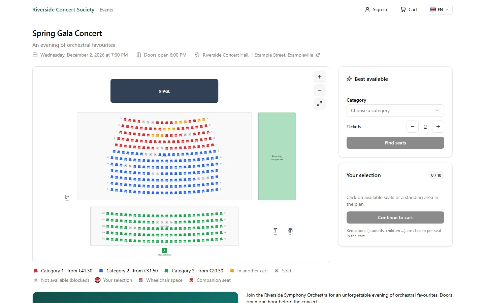
</p>

> **Status:** Vorabversion (`1.0.0-alpha.18`). Funktionsumfang vollständig, aber noch nicht als
> stabil freigegeben. Mach vor jedem Update ein Backup und lies das [CHANGELOG](CHANGELOG.md)
> (auf Englisch).

## Das bekommst du

<table>
  <tr>
    <td width="50%">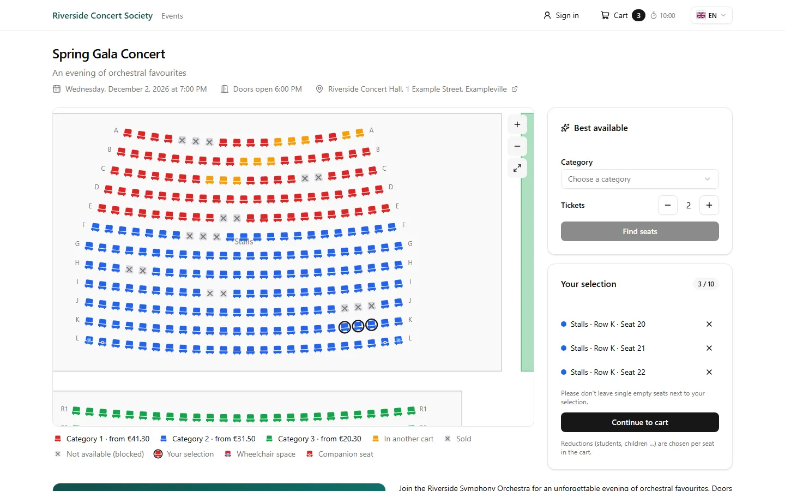<br><b>Echte Sitzpläne.</b> Kundinnen und Kunden wählen Plätze auf einem zoombaren Plan; jeder belegte Platz wird für alle anderen sofort grau. Bestplatzbuchung, Einzelplatz-Regel, Rollstuhl- und Begleitplätze.</td>
    <td width="50%">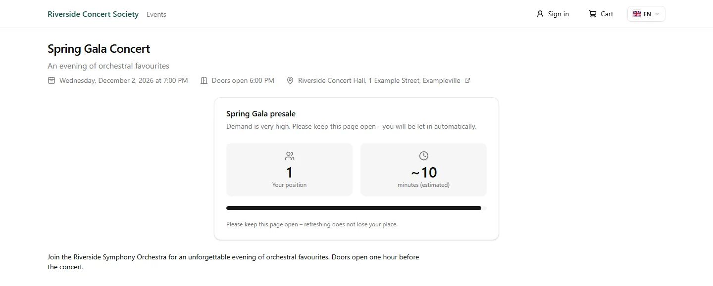<br><b>Virtueller Warteraum.</b> Automatisch ab einer Besucherschwelle, geplant mit Vorab-Lobby (der Reihe nach oder per Los) oder per Zugangscode. Position, Wartezeit und Durchsagen aktualisieren sich live.</td>
  </tr>
  <tr>
    <td>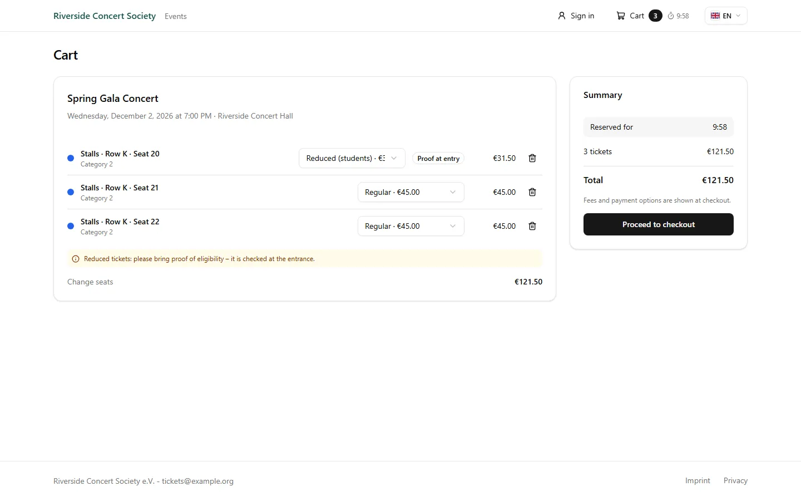<br><b>Warenkorb über mehrere Veranstaltungen.</b> Ein Warenkorb und eine Bestellung können mehrere Veranstaltungen umfassen. Ermäßigt, Rollstuhl oder Begleitung wählst du pro Platz; Nachweise werden am Einlass geprüft.</td>
    <td>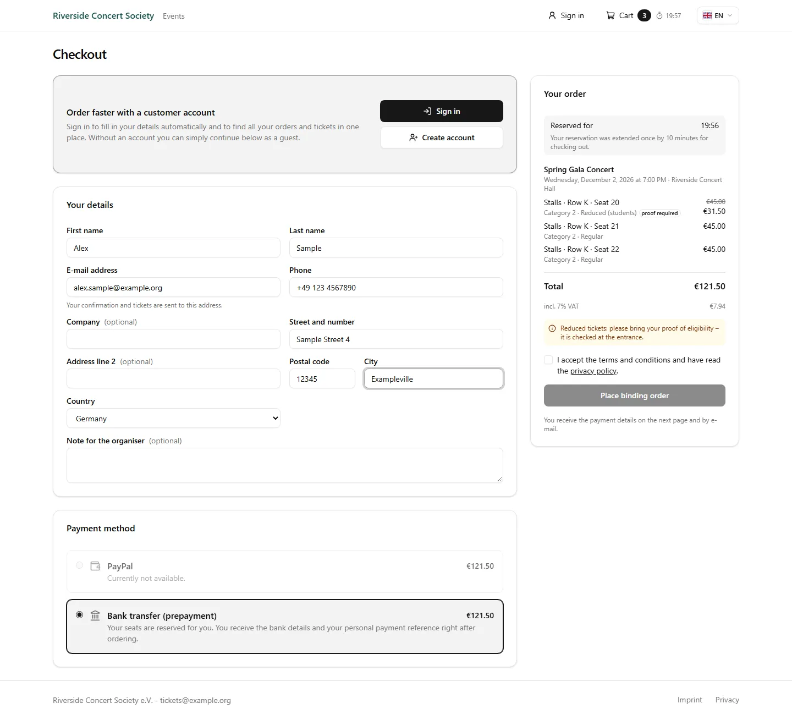<br><b>PayPal und Vorkasse.</b> Gastbestellung oder optionales Kundenkonto. Überweisungen werden automatisch zugeordnet (FinTS, finAPI, camt.052/053, MT940, CSV, IMAP); unklare Zahlungen landen in einer Klärfall-Liste.</td>
  </tr>
  <tr>
    <td>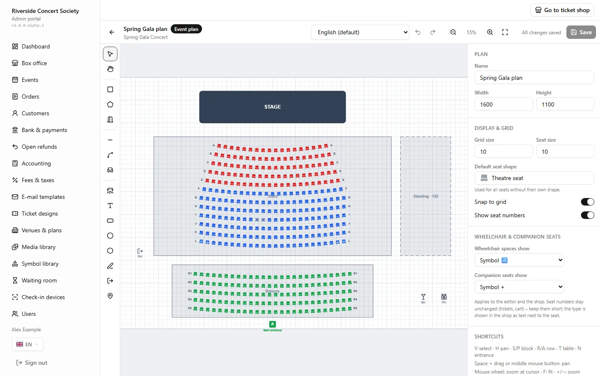<br><b>Visueller Sitzplan-Editor.</b> Zeichne Blöcke, Reihen, Tische und Stehplatzbereiche. Wiederverwendbare Saalvorlagen, pro Veranstaltung kopiert und anpassbar.</td>
    <td>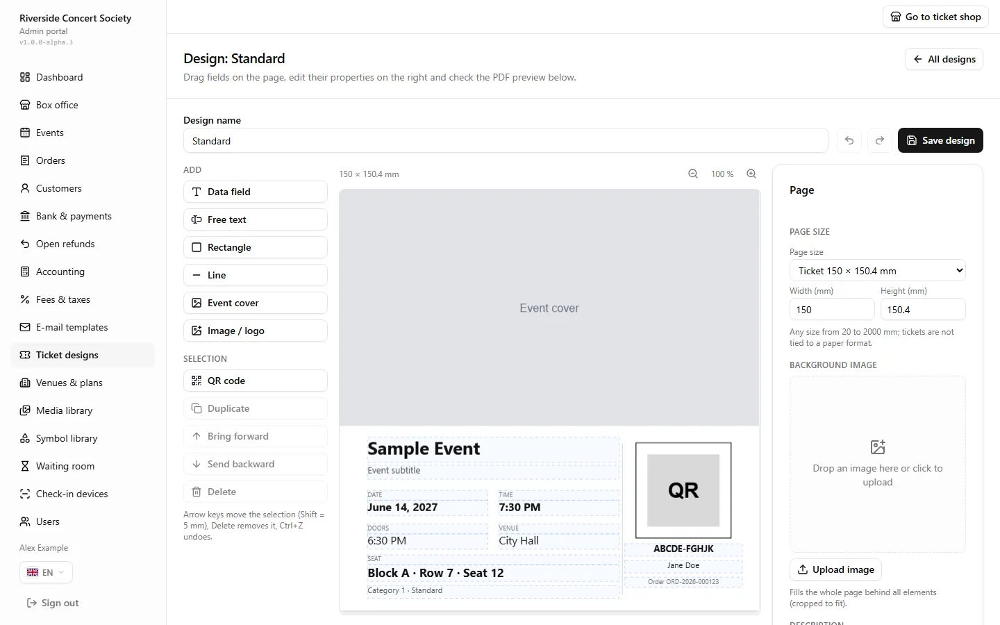<br><b>Ticket-Designer.</b> Dein Hintergrundbild, dein Layout, PDF-Vorschau live. Apple Wallet und Google Wallet sind optional.</td>
  </tr>
  <tr>
    <td>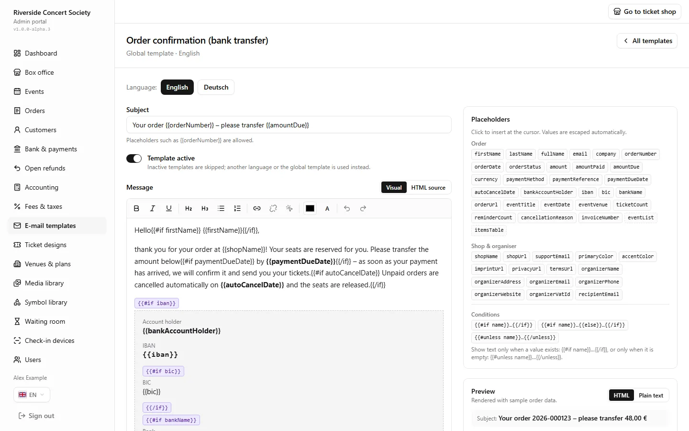<br><b>E-Mail-Vorlagen.</b> Rich-Text-Editor mit Platzhaltern, Vorschau und Test-Mail, Überschreibungen pro Veranstaltung.</td>
    <td>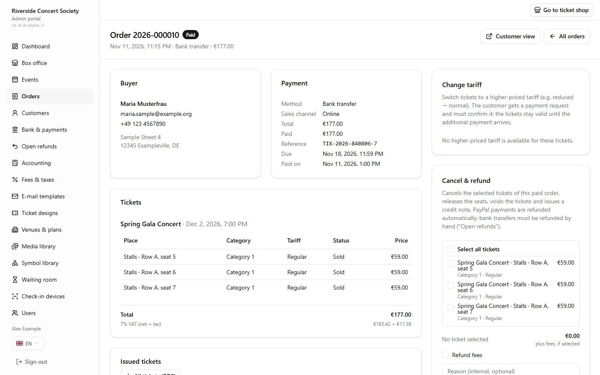<br><b>Bestellungen und Abendkasse.</b> Suchen, erneut senden, Plätze tauschen, stornieren, erstatten (PayPal automatisch), Gutschriften; Abendkassen- und Freikarten.</td>
  </tr>
  <tr>
    <td>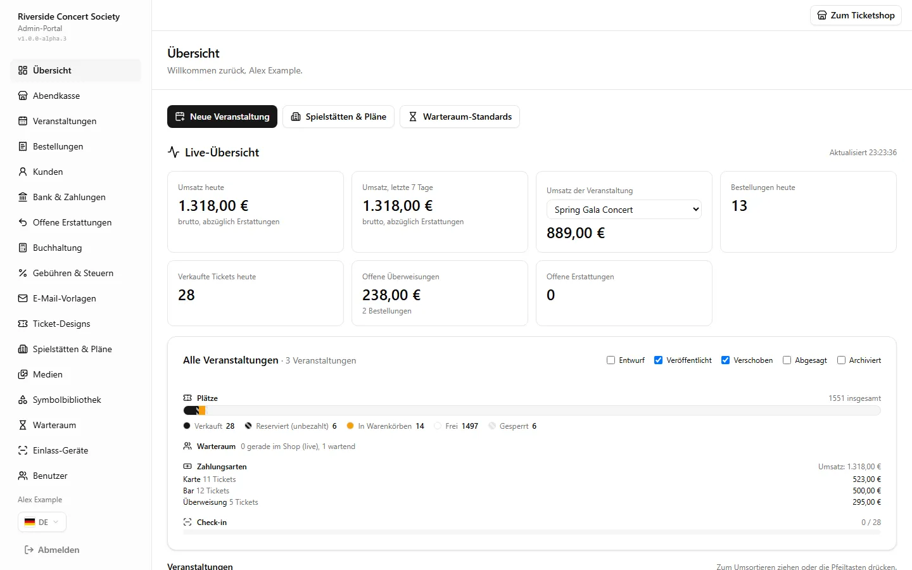<br><b>Live-Dashboard.</b> Umsatz, verkaufte / reservierte / freie Plätze, Warteschlange und Check-in-Fortschritt. Buchhaltungsexport für DATEV und CSV.</td>
    <td>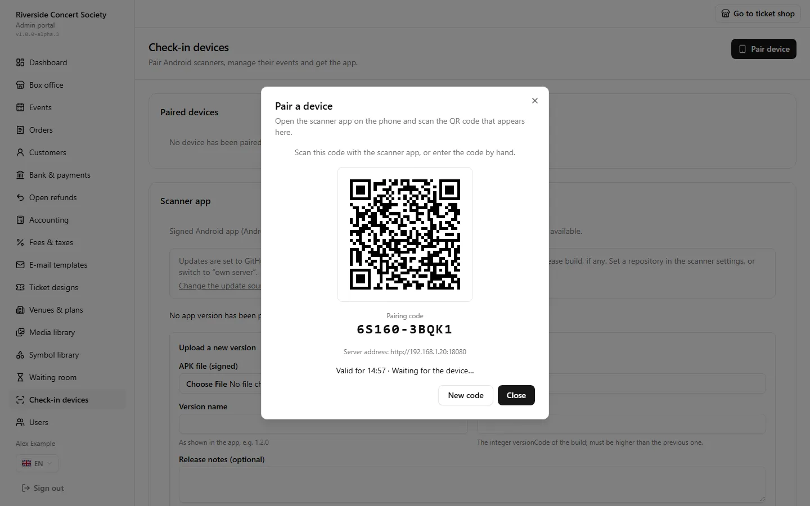<br><b>Einlass-Geräte.</b> Koppel Handys per QR-Code, sperre sie jederzeit, sieh Scan-Protokoll und Statistik.</td>
  </tr>
</table>

<table>
  <tr>
    <td width="33%" align="center">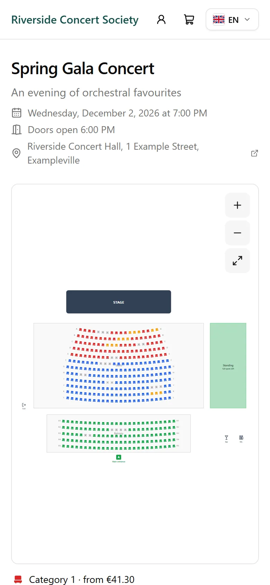</td>
    <td width="34%" align="center"></td>
    <td width="33%" align="center">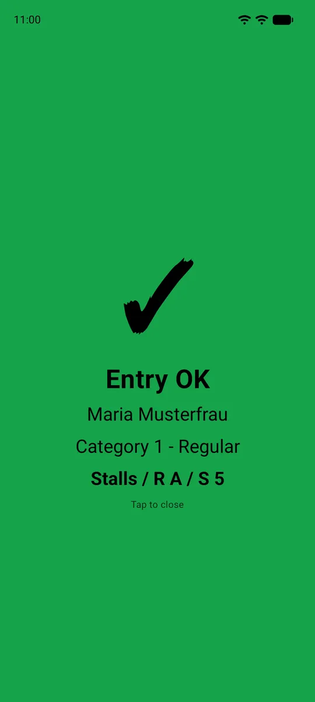</td>
  </tr>
  <tr>
    <td align="center">Shop für Smartphones</td>
    <td align="center">PDF-Ticket mit signiertem QR-Code</td>
    <td align="center">Check-in-App: grün / gelb / rot</td>
  </tr>
</table>

Alles Fachliche – Preise, Gebühren, Steuersätze, Layouts, E-Mail-Texte, Warteraum-Regeln,
Zugangsdaten, Erscheinungsbild – stellst du im Admin-Bereich ein; es liegt in der Datenbank. Die
Umgebungsdatei enthält nur Infrastruktur-Einstellungen. Shop und Admin gibt es auf **Deutsch und
Englisch**.

## Auf einen Blick

- **Lasttest:** 1.200 simulierte Nutzer kämpfen auf einer einzigen Maschine um dieselben Plätze,
  Warenkörbe und Bestellungen; geprüft wird, dass nie ein Platz doppelt vergeben wird
  ([docs/LOAD-TEST.md](docs/LOAD-TEST.md), Englisch).
- **Keine Doppelbuchungen:** Sitzsperren sind atomare Redis-Lua-Skripte, Bestellungen sind
  PostgreSQL-Transaktionen.
- **Offline-Einlass:** QR-Codes tragen eine Ed25519-Signatur pro Veranstaltung, das Handy prüft
  ein Ticket also ganz ohne Netz ([docs/TICKETS.md](docs/TICKETS.md)). Optionaler LAN-Abgleich
  über ein Master-Handy verhindert Doppeleinlass zwischen mehreren Eingängen.
- **Rechnungen:** lückenlose Nummern, unveränderlich (GoBD), Gutschriften, DATEV-Export.
- **Selbst gehostet:** dein Server, deine Daten. Docker Compose mit zwei Dateien. Keine
  Plattformgebühren.
- **Lieferkette:** Multi-Arch-Images (linux/amd64, linux/arm64), cosign-Signaturen, SBOM und
  Provenance, signierte Android-APK ([docs/RELEASES.md](docs/RELEASES.md)).
- **Quelloffen** unter der PolyForm Shield License 1.0.0.

## Architektur

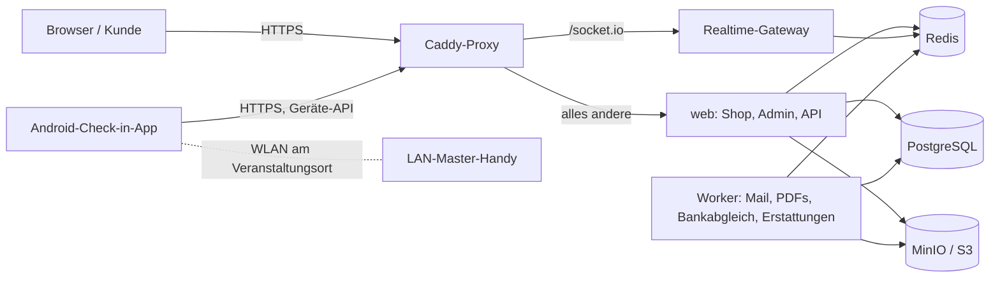

Mehr in [docs/ARCHITECTURE.md](docs/ARCHITECTURE.md) (Englisch).

## Schnellstart (5 Minuten)

Du brauchst einen Linux-Server mit Docker Engine und Docker Compose ab Version 2.23.1 sowie einen
Domainnamen, der auf den Server zeigt (Ports 80 und 443 offen). Die ausführliche Schritt-für-Schritt-
Anleitung mit HTTPS-Varianten und Fehlersuche ist [docs/INSTALL.de.md](docs/INSTALL.de.md).

```bash
# 1. Die zwei Dateien des Releases herunterladen
export TIX_VERSION=1.0.0-alpha.18
mkdir tix && cd tix
curl -fLO https://github.com/Renthner/tix-platform/releases/download/v$TIX_VERSION/docker-compose.yml
curl -fLO https://github.com/Renthner/tix-platform/releases/download/v$TIX_VERSION/env.example
mv env.example .env

# 2. Alle Geheimnisse erzeugen (den ganzen Block kopieren und einfügen)
gen() { openssl rand -hex 24; }
sed -i \
  -e "s|^POSTGRES_PASSWORD=.*|POSTGRES_PASSWORD=$(gen)|" \
  -e "s|^REDIS_PASSWORD=.*|REDIS_PASSWORD=$(gen)|" \
  -e "s|^SESSION_SECRET=.*|SESSION_SECRET=$(openssl rand -hex 32)|" \
  -e "s|^APP_ENCRYPTION_KEYS=.*|APP_ENCRYPTION_KEYS=k1:$(openssl rand -base64 32)|" \
  .env

# 3. Deine Domain eintragen (tickets.example.org ersetzen)
sed -i \
  -e "s|^PUBLIC_URL=.*|PUBLIC_URL=https://tickets.example.org|" \
  -e "s|^SITE_ADDRESS=.*|SITE_ADDRESS=tickets.example.org|" \
  -e "s|^HTTP_PORT=.*|HTTP_PORT=80|" \
  -e "s|^HTTPS_PORT=.*|HTTPS_PORT=443|" \
  .env

# 4. Starten, dann den ersten Admin anlegen (das Passwort wird nur einmal angezeigt)
docker compose up -d
docker compose run --rm migrate node dist/create-admin.mjs --email du@example.org --name "Dein Name"
```

Danach öffne `https://tickets.example.org/admin`.

**Sichere `APP_ENCRYPTION_KEYS` aus deiner `.env` außerhalb des Servers** (Passwortmanager). Ohne
sie lassen sich gespeicherte Geheimnisse und Backups nicht entschlüsseln. Die Kommentare in der
`.env` erklären jede Einstellung.

Solange es keine stabile Version gibt, existiert `releases/latest` nicht und der Image-Kanal
`stable` ist leer; die `.env` einer Vorabversion nutzt schon `TIX_CHANNEL=next`. Ab `1.0.0` kannst
du von `https://github.com/Renthner/tix-platform/releases/latest/download/<Datei>` laden.

## Check-in-App (Android)

Native Kotlin-App (Android 8+): fortlaufendes Kamera-Scannen, Vollbild-Ergebnis in grün / gelb /
rot, Offline-Datenbank mit Signaturprüfung, manuelle Suche und Check-out, Abgleich im Hintergrund.
Lade `tix-checkin-<Version>.apk` von der [Release-Seite](https://github.com/Renthner/tix-platform/releases)
und installiere sie (Installation aus dieser Quelle erlauben). Koppel jedes Handy mit dem QR-Code
unter **Admin → Einlass-Geräte**. Die App folgt immer der Version deines Servers und aktualisiert sich selbst über GitHub Releases
oder von deinem eigenen Server. Details:
[apps/android/README.md](apps/android/README.md), [docs/SCANNER.md](docs/SCANNER.md) (Englisch).

<table>
  <tr>
    <td width="50%" align="center">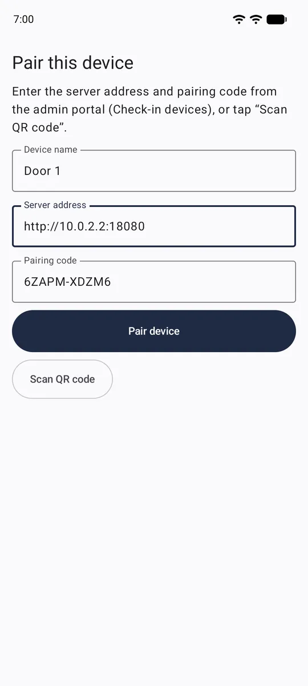<br>Manuelle Kopplung</td>
    <td width="50%" align="center"><br>Grün: Einlass OK</td>
  </tr>
</table>

## Dokumentation

| Dokument                                     | Inhalt                                             |
| -------------------------------------------- | -------------------------------------------------- |
| [docs/INSTALL.de.md](docs/INSTALL.de.md)     | Installation auf einem Server, Schritt für Schritt |
| [docs/README.de.md](docs/README.de.md)       | Verzeichnis der gesamten Dokumentation             |
| [docs/BACKUP.md](docs/BACKUP.md)             | Backups und Wiederherstellung (Englisch)           |
| [docs/RELEASES.md](docs/RELEASES.md)         | Versionen, Kanäle, Downloads prüfen (Englisch)     |
| [docs/ARCHITECTURE.md](docs/ARCHITECTURE.md) | Aufbau des Systems (Englisch)                      |
| [CHANGELOG.md](CHANGELOG.md)                 | Änderungen je Release (Englisch)                   |
| [CONTRIBUTING.md](CONTRIBUTING.md)           | Mitmachen (Englisch)                               |

## Entwicklung

Voraussetzungen: Node.js ≥ 24.7, pnpm 12 (`corepack enable pnpm`), Docker mit Compose v2.

```bash
pnpm install
pnpm infra:up               # PostgreSQL, Redis, Objektspeicher
pnpm db:migrate && pnpm db:seed
pnpm admin:create --email du@example.org --name "Dein Name"
pnpm db:demo                # optional: Demo-Saal + Veranstaltung im Verkauf (/events/demo-concert)
pnpm dev                    # web :3000, Realtime-Gateway :3001, Worker
```

Gesamter Stack aus dem Quellcode: `cp .env.example .env`, Geheimnisse eintragen, dann
`docker compose up -d --build` (Shop unter `http://localhost:8080`).

| Befehl                                  | Beschreibung                                                                                                                         |
| --------------------------------------- | ------------------------------------------------------------------------------------------------------------------------------------ |
| `pnpm typecheck`                        | TypeScript über alle Pakete                                                                                                          |
| `pnpm test`                             | Unit- und PostgreSQL-Integrationstests (braucht `TIX_TEST_THROWAWAY=1` + `TEST_DATABASE_URL`/`TEST_REDIS_URL` eines Wegwerf-Servers) |
| `pnpm db:generate`                      | Migration erzeugen, nachdem `packages/db/src/schema` geändert wurde                                                                  |
| `pnpm db:studio`                        | Drizzle Studio                                                                                                                       |
| `node scripts/smoke/shop.mjs <eventId>` | Ende-zu-Ende-Test von Sperren, Warenkorb, Tarifen, Realtime gegen laufende Server                                                    |
| `scripts/load/run.ps1 -Vus 1200`        | Lasttest in einem isolierten Stack, siehe [docs/LOAD-TEST.md](docs/LOAD-TEST.md)                                                     |

Health-Endpunkte: `GET /api/health?probe=live` (Liveness), `GET /api/health` (Bereitschaft:
PostgreSQL, Redis, laufende Worker), Worker `:8081/healthz`, Realtime `:3001/healthz`.

## Releases und Prüfung

Versionen folgen SemVer mit Vorabversions-Tags. Jedes Release enthält signierte Container-Images
(GHCR), die signierte Android-APK, `docker-compose.yml`, `env.example` und `SHA256SUMS.txt`. Wie du
sie prüfst und wie die Kanäle (`next`, `stable`, …) funktionieren, steht in
[docs/RELEASES.md](docs/RELEASES.md) (Englisch).

## Lizenz

Quelloffen unter der [PolyForm Shield License 1.0.0](LICENSE). Maßgeblich ist der Lizenztext; in
einfachen Worten ist gemeint:

### Erlaubt (kostenlos)

- Einen eigenen Ticketshop für die Veranstaltungen betreiben, die du selbst organisierst – Vereine,
  Theater, Schulen, Firmen –, auch mit eigenen Preisen und Gebühren für deine Ticketkäufer.
- Den Code für den eigenen Shop ändern und diese Änderungen unter denselben Bedingungen weitergeben.
- Eine Dienstleisterin oder einen Dienstleister beauftragen, ihn _für dich_ als deinen eigenen
  Shop zu installieren, zu hosten oder anzupassen.

### Nicht erlaubt

- Diese Software oder ein davon abgeleitetes Produkt verkaufen.
- Auf Basis dieser Software ein Ticketsystem oder einen Ticketdienst für andere Veranstalter
  anbieten (z. B. als mandantenfähigen Dienst hosten oder Plattformgebühren über mehrere
  Veranstalter einnehmen).

Das ist keine von der OSI anerkannte Open-Source-Lizenz, weil sie konkurrierende Nutzung
einschränkt.

## Sicherheit

Melde Sicherheitslücken bitte vertraulich, siehe [SECURITY.md](SECURITY.md).
