# TIX – Self-hosted ticketing platform

**Sell tickets for your own concerts, plays and club events – with a real seating plan, a waiting
room for busy presales and an offline-capable check-in app. On your own server, without platform
fees.**

[](https://github.com/Renthner/tix-platform/releases)
[](https://github.com/Renthner/tix-platform/actions/workflows/ci.yml)
[](LICENSE)


English | [Deutsch](README.de.md)

<p align="center">
  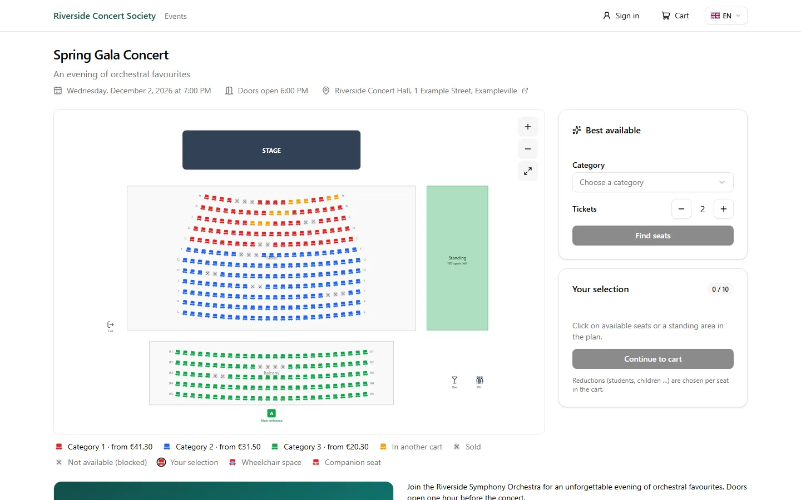
</p>

> **Status:** pre-release (`1.0.0-alpha.9`). Feature-complete, but not yet declared stable. Take a
> backup before every update and read the [CHANGELOG](CHANGELOG.md).

## What you get

<table>
  <tr>
    <td width="50%">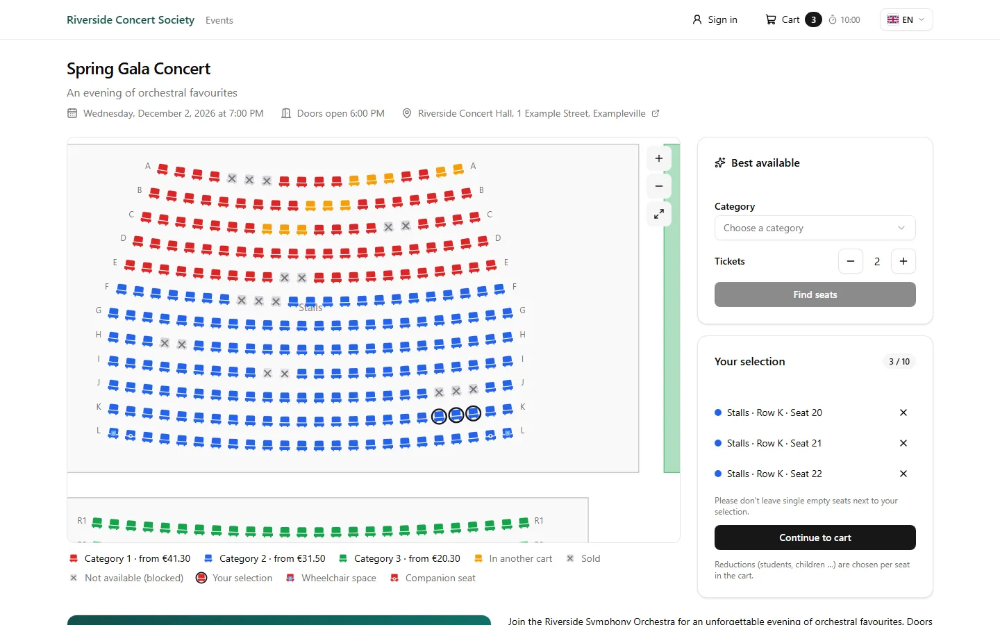<br><b>Real seating plans.</b> Customers pick seats on a zoomable plan; every seat turns grey for all other visitors within a moment. Best-available booking, orphan-seat rule, wheelchair and companion seats.</td>
    <td width="50%">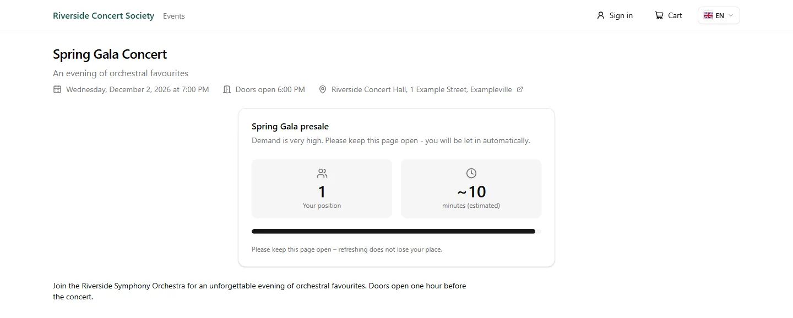<br><b>Virtual waiting room.</b> Automatic at a visitor threshold, scheduled with a pre-registration lobby (first come or lottery), or by access code. Position, estimated wait and announcements update live.</td>
  </tr>
  <tr>
    <td>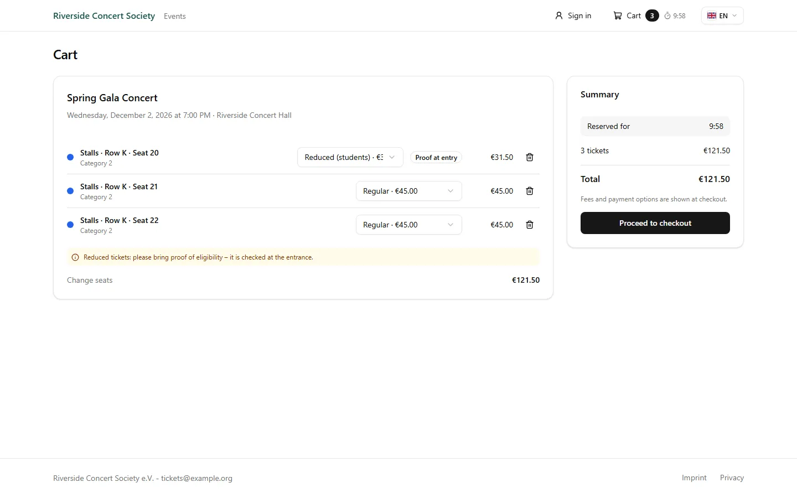<br><b>Multi-event cart.</b> One cart and one order can span several events. Reduced, wheelchair or companion tariffs are chosen per seat; proofs are checked at the door.</td>
    <td>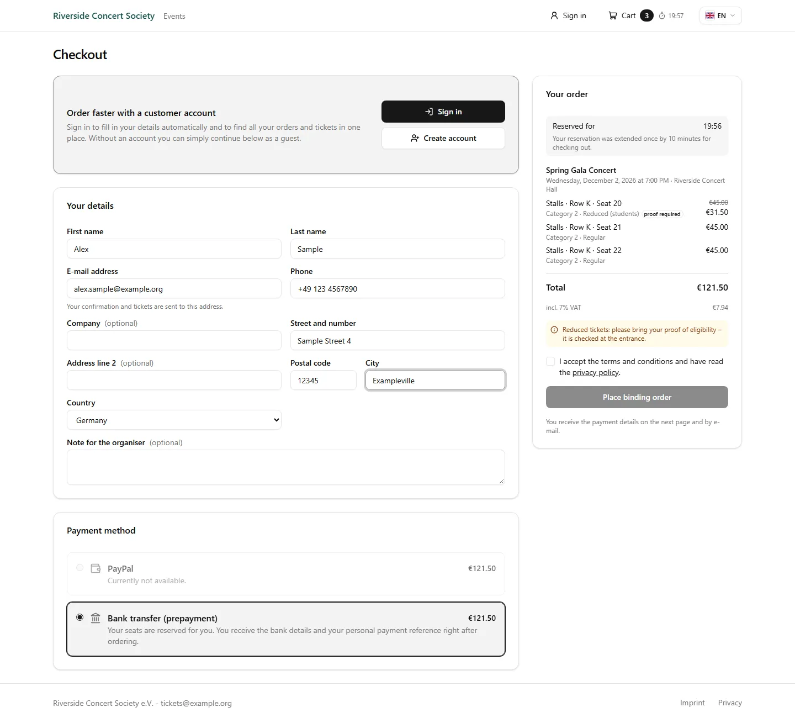<br><b>PayPal and bank transfer.</b> Guest checkout or optional customer accounts. Bank transfers are matched automatically (FinTS, finAPI, camt.052/053, MT940, CSV, IMAP); unclear payments land in a review queue.</td>
  </tr>
  <tr>
    <td>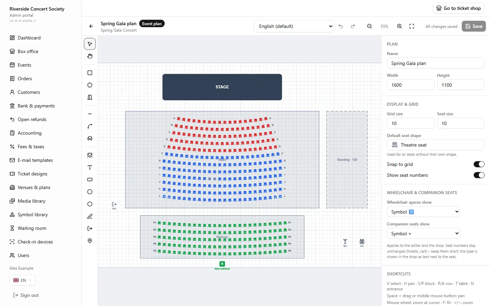<br><b>Visual seating plan editor.</b> Draw blocks, rows, tables and standing areas. Reusable venue templates, copied and adjustable per event.</td>
    <td>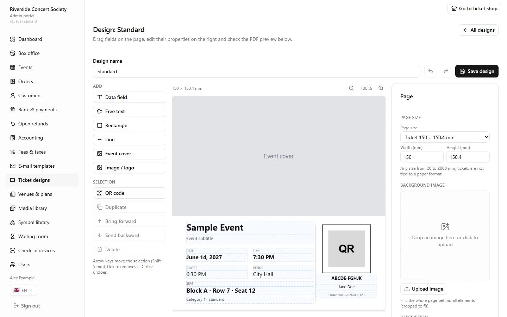<br><b>Ticket designer.</b> Your artwork, your layout, live PDF preview. Apple Wallet and Google Wallet passes are optional.</td>
  </tr>
  <tr>
    <td>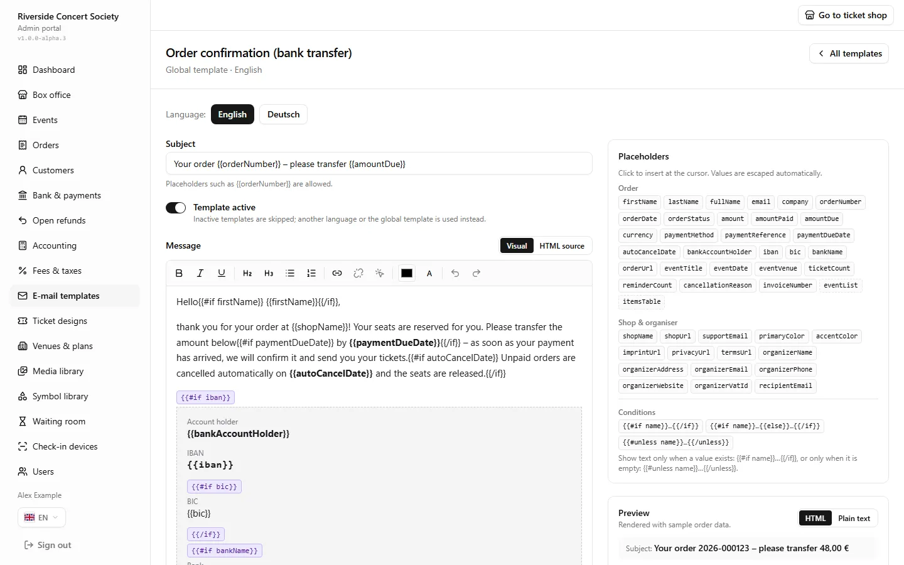<br><b>E-mail templates.</b> Rich-text editor with placeholders, preview and test mail, per event overrides.</td>
    <td>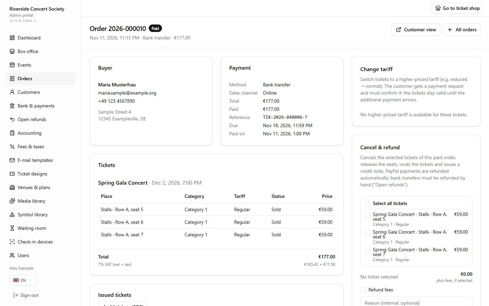<br><b>Orders and box office.</b> Search, resend, change seats, cancel, refund (PayPal automatic), credit notes; box-office and complimentary tickets.</td>
  </tr>
  <tr>
    <td>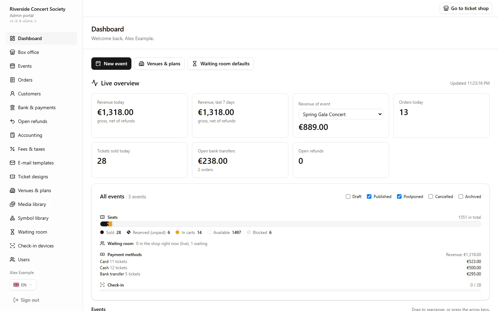<br><b>Live dashboard.</b> Revenue, sold / reserved / free seats, queue and check-in progress. Accounting export for DATEV and CSV.</td>
    <td>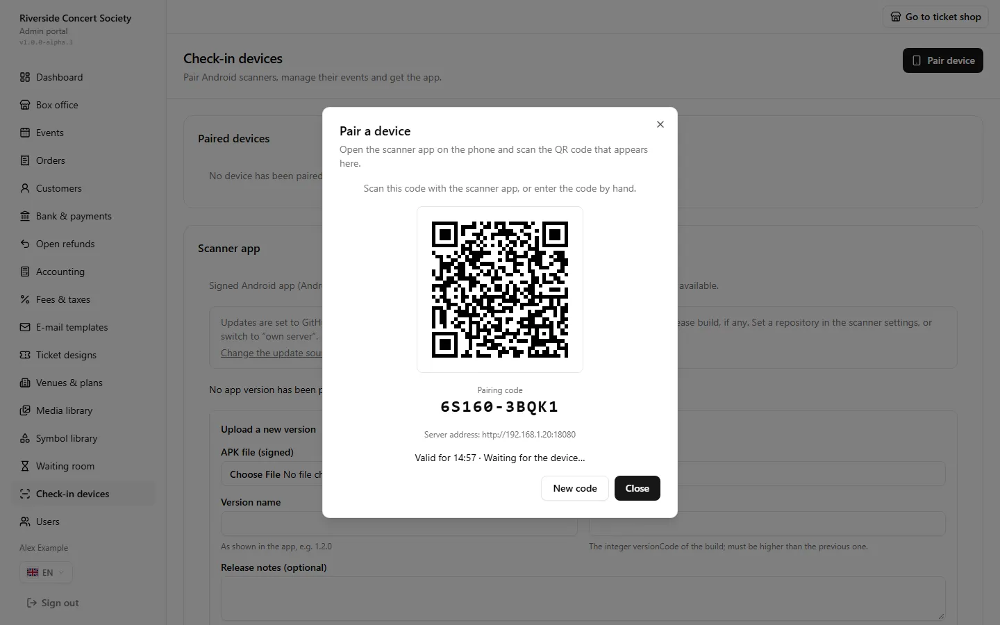<br><b>Check-in devices.</b> Pair phones with a QR code, revoke them any time, watch the scan log and statistics.</td>
  </tr>
</table>

<table>
  <tr>
    <td width="33%" align="center">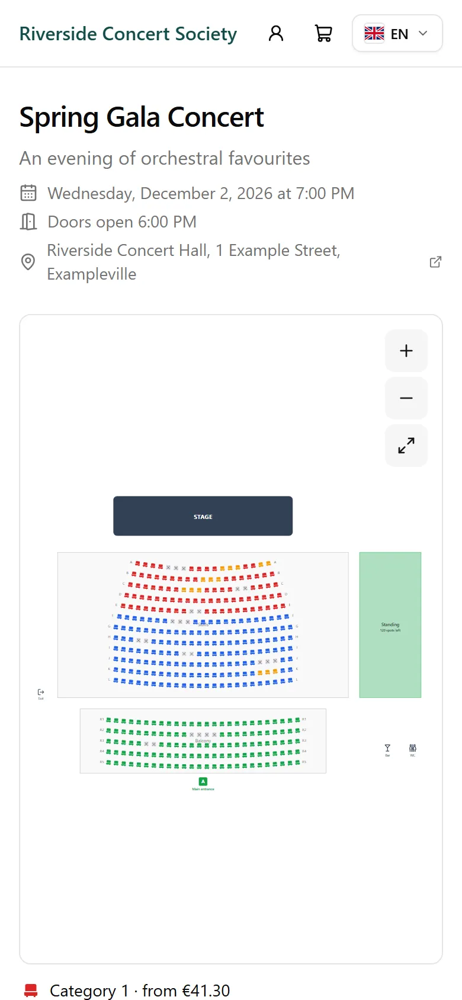</td>
    <td width="34%" align="center"></td>
    <td width="33%" align="center">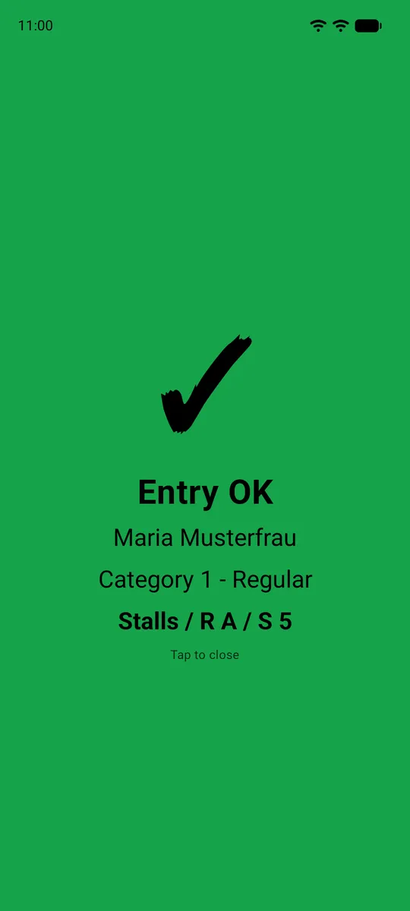</td>
  </tr>
  <tr>
    <td align="center">Mobile-friendly shop</td>
    <td align="center">PDF ticket with signed QR code</td>
    <td align="center">Check-in app: green / yellow / red</td>
  </tr>
</table>

Everything business-related – prices, fees, tax rates, layouts, e-mail texts, queue rules,
credentials, branding – is configured in the Admin Portal and stored in the database. The
environment file only contains infrastructure settings. The shop and the admin are available in
**English and German**.

## At a glance

- **Load-tested:** 1,200 simulated users racing for the same seats, carts and orders on a single
  machine, with checks that no seat is ever granted twice ([docs/LOAD-TEST.md](docs/LOAD-TEST.md)).
- **No double bookings:** seat locks are atomic Redis Lua scripts; orders are PostgreSQL
  transactions.
- **Offline check-in:** QR codes carry an Ed25519 signature per event, so a phone verifies a ticket
  without any network ([docs/TICKETS.md](docs/TICKETS.md)). Optional LAN sync through one master
  phone prevents double entry between doors.
- **Invoices:** gapless numbers, immutable (GoBD), credit notes, DATEV export.
- **Self-hosted:** your server, your data. Docker Compose with two files. No platform fees.
- **Supply chain:** multi-arch images (linux/amd64, linux/arm64), cosign signatures, SBOM and
  provenance, signed Android APK ([docs/RELEASES.md](docs/RELEASES.md)).
- **Source-available** under the PolyForm Shield License 1.0.0.

## Architecture

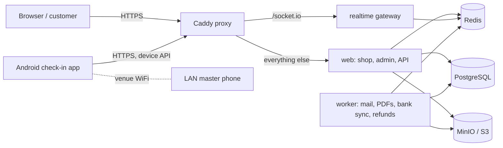

More in [docs/ARCHITECTURE.md](docs/ARCHITECTURE.md).

## Quick start (5 minutes)

You need a Linux server with Docker Engine and Docker Compose 2.23.1 or newer, and a domain name
that points to the server (ports 80 and 443 open). The full, step-by-step guide with HTTPS options
and troubleshooting is [docs/INSTALL.md](docs/INSTALL.md).

```bash
# 1. Download the two files of the release
export TIX_VERSION=1.0.0-alpha.9
mkdir tix && cd tix
curl -fLO https://github.com/Renthner/tix-platform/releases/download/v$TIX_VERSION/docker-compose.yml
curl -fLO https://github.com/Renthner/tix-platform/releases/download/v$TIX_VERSION/env.example
mv env.example .env

# 2. Generate all secrets (copy and paste the whole block)
gen() { openssl rand -hex 24; }
sed -i \
  -e "s|^POSTGRES_PASSWORD=.*|POSTGRES_PASSWORD=$(gen)|" \
  -e "s|^REDIS_PASSWORD=.*|REDIS_PASSWORD=$(gen)|" \
  -e "s|^MINIO_ROOT_PASSWORD=.*|MINIO_ROOT_PASSWORD=$(gen)|" \
  -e "s|^S3_SECRET_ACCESS_KEY=.*|S3_SECRET_ACCESS_KEY=$(gen)|" \
  -e "s|^SESSION_SECRET=.*|SESSION_SECRET=$(openssl rand -hex 32)|" \
  -e "s|^APP_ENCRYPTION_KEYS=.*|APP_ENCRYPTION_KEYS=k1:$(openssl rand -base64 32)|" \
  .env

# 3. Set your domain (replace tickets.example.org)
sed -i \
  -e "s|^PUBLIC_URL=.*|PUBLIC_URL=https://tickets.example.org|" \
  -e "s|^SITE_ADDRESS=.*|SITE_ADDRESS=tickets.example.org|" \
  -e "s|^HTTP_PORT=.*|HTTP_PORT=80|" \
  -e "s|^HTTPS_PORT=.*|HTTPS_PORT=443|" \
  .env

# 4. Start, then create the first admin (the password is printed once)
docker compose up -d
docker compose run --rm migrate node dist/create-admin.mjs --email you@example.org --name "Your Name"
```

Then open `https://tickets.example.org/admin`.

**Back up `APP_ENCRYPTION_KEYS` from your `.env` outside the server** (password manager). Without
it, stored secrets and backups cannot be decrypted. The comments in `.env` explain every setting.

While there is no stable release, `releases/latest` does not exist and the `stable` image channel
is empty; the pre-release `.env` already uses `TIX_CHANNEL=next`. From `1.0.0` on you can download
from `https://github.com/Renthner/tix-platform/releases/latest/download/<file>`.

## Check-in app (Android)

Native Kotlin app (Android 8+): continuous camera scanning, full-screen green / yellow / red
result, offline database with signature verification, manual search and check-out, background
sync. Download `tix-checkin-<version>.apk` from the [release page](https://github.com/Renthner/tix-platform/releases)
and install it (allow installing from this source). Pair each phone with the QR code from
**Admin → Check-in devices**. The app always follows the version of your server and updates itself from GitHub Releases
or from your own server. Details: [apps/android/README.md](apps/android/README.md),
[docs/SCANNER.md](docs/SCANNER.md).

<table>
  <tr>
    <td width="50%" align="center">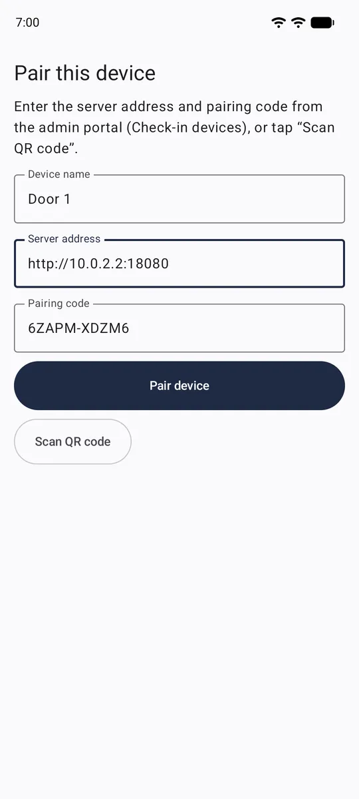<br>Manual pairing</td>
    <td width="50%" align="center"><br>Green: entry OK</td>
  </tr>
</table>

## Documentation

| Document                                     | Content                                           |
| -------------------------------------------- | ------------------------------------------------- |
| [docs/INSTALL.md](docs/INSTALL.md)           | Install on a server step by step (also in German) |
| [docs/README.md](docs/README.md)             | Index of all documentation                        |
| [docs/BACKUP.md](docs/BACKUP.md)             | Backups and restore                               |
| [docs/RELEASES.md](docs/RELEASES.md)         | Versions, channels, verifying downloads           |
| [docs/ARCHITECTURE.md](docs/ARCHITECTURE.md) | How the system is built                           |
| [CHANGELOG.md](CHANGELOG.md)                 | What changed in each release                      |
| [CONTRIBUTING.md](CONTRIBUTING.md)           | How to contribute                                 |

## Development

Requirements: Node.js ≥ 24.7, pnpm 12 (`corepack enable pnpm`), Docker with Compose v2.

```bash
pnpm install
pnpm infra:up               # PostgreSQL, Redis, object storage
pnpm db:migrate && pnpm db:seed
pnpm admin:create --email you@example.org --name "Your Name"
pnpm db:demo                # optional: demo venue + event on sale (/events/demo-concert)
pnpm dev                    # web :3000, realtime gateway :3001, worker
```

Full stack from source: `cp .env.example .env`, fill in the secrets, then
`docker compose up -d --build` (shop on `http://localhost:8080`).

| Command                                 | Description                                                                  |
| --------------------------------------- | ---------------------------------------------------------------------------- |
| `pnpm typecheck`                        | TypeScript across all packages                                               |
| `pnpm test`                             | Unit tests + PostgreSQL integration tests (needs `TEST_DATABASE_URL`)        |
| `pnpm db:generate`                      | Generate a migration after changing `packages/db/src/schema`                 |
| `pnpm db:studio`                        | Drizzle Studio                                                               |
| `node scripts/smoke/shop.mjs <eventId>` | End-to-end check of locking, cart, tariffs, realtime against running servers |
| `scripts/load/run.ps1 -Vus 1200`        | Load test in an isolated stack, see [docs/LOAD-TEST.md](docs/LOAD-TEST.md)   |

Health endpoints: `GET /api/health?probe=live` (liveness), `GET /api/health` (readiness:
PostgreSQL, Redis, live workers), worker `:8081/healthz`, realtime `:3001/healthz`.

## Releases and verification

Versions follow SemVer with pre-release tags. Every release publishes signed container images
(GHCR), the signed Android APK, `docker-compose.yml`, `env.example` and `SHA256SUMS.txt`. How to
verify them and how channels (`next`, `stable`, …) work: [docs/RELEASES.md](docs/RELEASES.md).

## Licence

Source-available under the [PolyForm Shield License 1.0.0](LICENSE). The licence text is
binding; in plain words, the intent is:

### Allowed (free of charge)

- Running your own ticket shop for the events you organise – clubs, associations, theatres,
  schools, companies, including charging your own ticket buyers prices and fees.
- Modifying the code for your own shop and sharing those modifications under the same terms.
- Having a contractor install, host or customise it _for you_ as your own shop.

### Not allowed

- Selling this software or a product derived from it.
- Offering a ticketing platform or ticketing service to other organisers based on this
  software (e.g. hosting it as a multi-tenant service or earning platform fees across
  organisers).

This is not an OSI-approved open-source license, because it restricts competing use.

## Security

Please report vulnerabilities privately, see [SECURITY.md](SECURITY.md).
